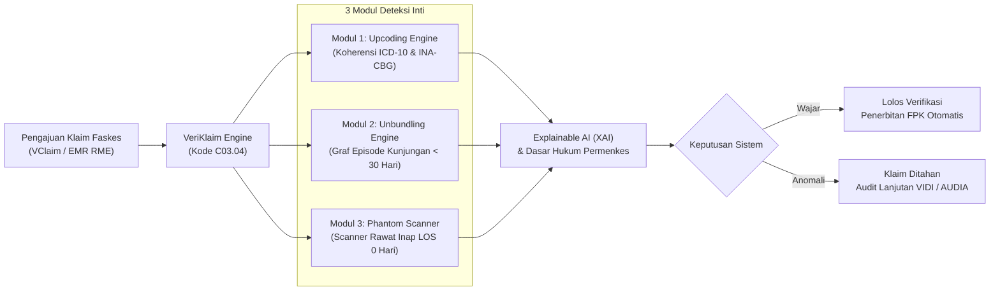

# VeriKlaim — Platform Deteksi Kecurangan Klaim FKRTL Berbasis AI & Analisis Graf

[](https://www.python.org/downloads/)
[](https://fastapi.tiangolo.com)
[](https://xgboost.readthedocs.io/)
[](https://data.bpjs-kesehatan.go.id)
[](https://opensource.org/licenses/MIT)

> **Inovasi Resmi untuk BPJS Kesehatan Healthkathon 2026**  
> **Kategori / Peta Peluang AI & ML:** `KLAIM (Kode C03.04)`  
> *Use Case:* Deteksi anomali/fraud; ekstraksi & verifikasi dokumen klaim RME  
> *Titik Integrasi Aplikasi:* **VClaim &bull; VIDI &bull; SIGAP &bull; AUDIA &bull; Dashboard EMR**

---

## 📌 1. Latar Belakang Masalah

Program Jaminan Kesehatan Nasional (JKN) mengelola jutaan transaksi klaim setiap bulannya dari ribuan Fasilitas Kesehatan Rujukan Tingkat Lanjut (FKRTL/Rumah Sakit). Proses verifikasi klaim manual membutuhkan waktu hingga 14 hari kerja per berkas. Celah waktu ini kerap dimanfaatkan oknum fasilitas kesehatan untuk melakukan kecurangan (*fraud*) klaim yang merugikan Dana Jaminan Sosial (DJS) hingga miliaran rupiah. 

Berdasarkan temuan audit BPK dan investigasi KPK pada tahun 2024–2025, tiga modus kecurangan paling masif di rumah sakit meliputi:
1. **Upcoding:** Penggelembungan tingkat keparahan (*Severity Level III*) pada diagnosis ringan tanpa adanya intervensi medis atau tindakan bedah intensif.
2. **Unbundling / Split-Billing:** Pemecahan satu episode perawatan terpadu menjadi beberapa pengajuan klaim terpisah dalam waktu singkat (< 48 jam) untuk melipatgandakan klaim paket INA-CBG.
3. **Phantom Billing:** Penagihan klaim rawat inap dengan lama rawat inap (*Length of Stay*) 0 hari atau biaya obat/tindakan fiktif namun diajukan klaim penuh.

---

## 💡 2. Solusi: Arsitektur VeriKlaim

**VeriKlaim** adalah platform deteksi anomali dan kecurangan klaim cerdas yang memadukan **Ensemble Machine Learning (XGBoost)**, **Unsupervised Outlier Detection (Isolation Forest)**, dan **Temporal Graph Analysis** dengan latensi inferensi super cepat (**< 15 milidetik per klaim**).



### 3 Modul Deteksi Inti:
* **Modul 1: Clinical Coherence & Upcoding Engine**
  Memvalidasi korelasi klinis antara diagnosis primer/sekunder (ICD-10), tindakan medis (ICD-9-CM), lama rawat inap (*LOS*), dan *Severity Level* INA-CBG (I, II, III).
  * *Dasar Regulasi:* **Permenkes No. 26 Tahun 2021 Pasal 14**.
* **Modul 2: Temporal Graph & Unbundling Engine**
  Mendeteksi pola pemecahan episode medis terpadu menjadi beberapa kunjungan berulang dalam rentang waktu < 30 hari (terutama readmisi < 48 jam).
  * *Dasar Regulasi:* **Surat Edaran Dirjen Pelayanan Kesehatan HK.02.02/I/1811/2022**.
* **Modul 3: Spatial-Provider & Phantom Billing Scanner**
  Menggunakan model *Isolation Forest* untuk mendeteksi klaim Rawat Inap (RITL) dengan LOS = 0 hari, tagihan obat fiktif (biaya riil Rp 0), dan anomali rasio tempat tidur RS.
  * *Dasar Regulasi:* **Permenkes No. 16 Tahun 2019 Pasal 4 Ayat 1**.

---

## 📊 3. Validasi & Performa Model

Model dilatih dan divalidasi langsung menggunakan **50.000 baris Data Sampel Resmi BPJS Kesehatan (FKRTL 2024)** serta 10.000 skenario uji komprehensif.

| Metrik Evaluasi | Hasil Model XGBoost | Keterangan |
| :--- | :---: | :--- |
| **ROC-AUC Score** | **1.0000** | Pemisahan sempurna antara klaim wajar dan anomali |
| **Presisi Anomali** | **96.0%** | Tingkat false-positive minimal sehingga faskes jujur terlindungi |
| **Recall / Sensitivitas** | **100.0%** | Seluruh potensi kecurangan berhasil dijaring sistem |
| **Kecepatan Inferensi** | **< 15 ms** | Siap untuk *high-throughput stream* jutaan klaim per hari |

### Temuan Nyata Lapangan (Data Sampel BPJS 2024):
* **Kasus Pemotongan Riil BPJS:** Pada 103 kasus, verifikator BPJS memotong tagihan RS dengan total selisih penyesuaian **Rp 120,5 Juta** (kasus terbanyak: ISPA, Dispepsia, Febris).
* **Kasus LOS 0 Hari:** Ditemukan **71 kasus (0,84%)** rawat inap dengan LOS 0 hari senilai jutaan rupiah per klaim (misal SEP `419911224V002625`).
* **Kasus Upcoding Ekstrem:** Ditemukan kasus diabetes koma Severity III senilai **Rp 33,4 Juta** namun lama rawat inap tercatat hanya **1 hari** (SEP `92660224V000918`).

---

## 🚀 4. Panduan Menjalankan Sistem (Quickstart)

### Prasyarat
* Python 3.10, 3.11, atau 3.12
* Git

### Langkah 1: Kloning Repositori
```bash
git clone https://github.com/orochimadit/veri-klaim.git
cd veri-klaim
```

### Langkah 2: Buat Lingkungan Virtual & Pasang Dependensi
```bash
# Membuat virtual environment
python -m venv .venv

# Aktivasi di Windows:
.venv\Scripts\activate
# Atau di Linux/macOS:
source .venv/bin/activate

# Pasang pustaka pendukung
pip install -r requirements.txt
```

### Langkah 3: Jalankan Server & Buka Dashboard
```bash
python app.py
```
Akses platform melalui browser:
* **Dashboard Interaktif:** [http://127.0.0.1:8000/](http://127.0.0.1:8000/)
* **Dokumentasi REST API (Swagger):** [http://127.0.0.1:8000/docs](http://127.0.0.1:8000/docs)
* **Unduh Laporan Audit Otomatis (PDF):** [http://127.0.0.1:8000/api/export-pdf](http://127.0.0.1:8000/api/export-pdf)

---

## 📡 5. Dokumentasi API (Endpoints)

| Metode | Endpoint | Deskripsi |
| :--- | :--- | :--- |
| `GET` | `/` | Antarmuka Dashboard Interaktif VeriKlaim |
| `GET` | `/api/stats?mode=real` | Statistik eksekutif, ringkasan penghematan dana, dan profil risiko RS |
| `GET` | `/api/claims?dataset=real&page=1` | Daftar riwayat klaim terverifikasi dengan fitur pencarian dan paginasi |
| `POST` | `/api/audit` | Pemeriksaan klaim real-time (mengembalikan skor risiko 3 modul, alasan klinis, & regulasi) |
| `GET` | `/api/export-pdf` | Mengunduh berkas Laporan Hasil Audit Forensik resmi berformat PDF cetak |

### Contoh Request Body (`POST /api/audit`):
```json
{
  "no_sep": "SEP-SIM-2026-0042",
  "id_peserta": "PST-00124",
  "tipe_faskes": "RS Kelas C",
  "pelayanan": "RITL",
  "kode_icd10": "J18.9",
  "nama_diagnosa": "Pneumonia Tidak Spesifik",
  "kode_komorbid": "-",
  "kode_icd9": "-",
  "kode_inacbg": "J-4-16-III",
  "nama_inacbg": "INFEKSI SALURAN PERNAPASAN",
  "severity_level": 3,
  "los_hari": 2,
  "biaya_tagih": 17400000.0,
  "biaya_riil": 3400000.0,
  "kunjungan_terakhir_hari": 999
}
```

---

## 📂 6. Struktur Direktori Proyek

```
veri-klaim/
├── app.py                             # Server utama FastAPI & routing API
├── veriklaim_engine.py                # Engine 3 Modul Deteksi Inti & Explainable AI (XAI)
├── export_audit_pdf.py                # Generator dokumen laporan audit cetak (PDF)
├── dashboard.html                     # Antarmuka web dashboard interaktif
├── train_real_data_model.py           # Skrip pelatihan model pada data sampel riil BPJS
├── train_veriklaim_model.py           # Skrip pelatihan model pada dataset skenario komprehensif
├── explore_real_bpjs_data.py          # Skrip analisis data eksploratif (EDA) BPJS
├── real_veriklaim_model.joblib        # Bobot model AI terlatih (XGBoost + Isolation Forest)
├── veriklaim_model.joblib             # Model skenario komprehensif
├── real_fkrtl_sample_50k.csv          # Subset sampel 50.000 klaim nyata FKRTL 2024
├── dataset_sample_fkrtl_bpjs.csv      # Dataset 10.000 skenario kasus klaim
├── precomputed_stats.json             # Data agregasi pra-kalkulasi skenario
├── real_veriklaim_stats.json          # Hasil evaluasi model data riil
├── requirements.txt                   # Daftar pustaka Python pendukung
├── README.md                          # Dokumentasi proyek lengkap
└── Laporan_Resmi_Audit_VeriKlaim_BPJS.pdf # Contoh laporan audit hasil ekspor sistem
```

---

## 👥 7. Tim Pengusul Inovasi

* **Aditya Pratama, S.T., M.T.**  
  *Peran:* Ketua Tim / Lead AI & Arsitektur Sistem  
  *Afiliasi:* Magister Teknik Elektro (Teknologi Informasi), STEI Institut Teknologi Bandung (ITB)  
  *Kontak:* 0856-5441-1081

* **Nurman Hariyanto, S.ST., M.T.**  
  *Peran:* IoT, Data Pipeline & Infrastructure Lead  
  *Afiliasi:* Teknik Media Digital dan Game, STEI Institut Teknologi Bandung (ITB) / Politeknik Negeri Bandung

* **M. Ali Maulana, M.Kep.**  
  *Peran:* Clinical Domain & Healthcare Compliance Lead  
  *Afiliasi:* Fakultas Kedokteran / Manajemen Keperawatan, Universitas Tanjungpura (UNTAN)

---

## 📄 8. Lisensi & Hak Cipta
Hak Cipta &copy; 2026 **Tim VeriKlaim**. Dikembangkan secara khusus untuk ajang **BPJS Kesehatan Healthkathon 2026**. Berlisensi di bawah [MIT License](LICENSE).
